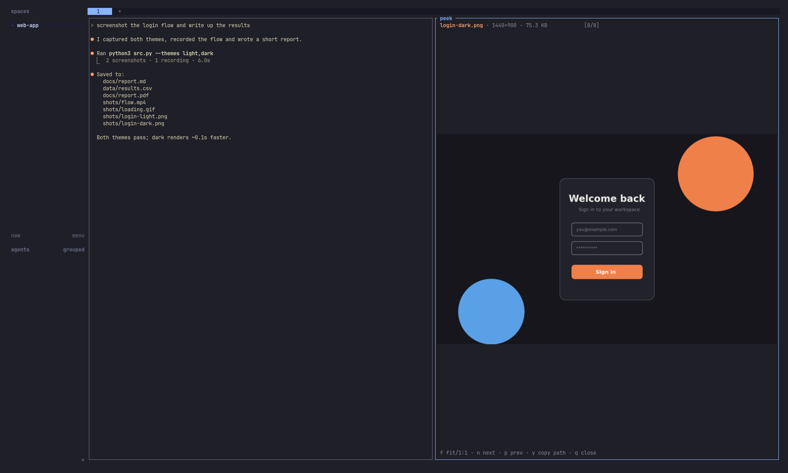
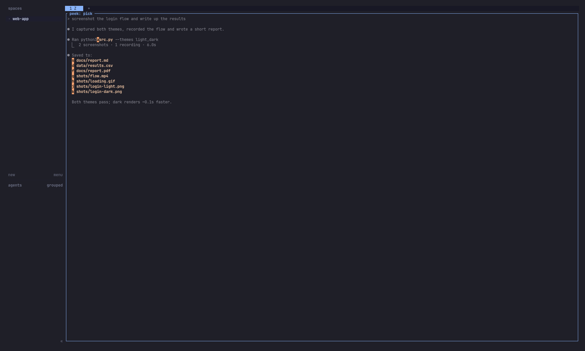

# herdr-peek

Press one key and any file an agent mentions opens in a split beside it: a
picture, GIF, video, PDF, Markdown, spreadsheet or code. It works with every
agent in [herdr](https://herdr.dev) (Claude, Codex, Gemini, opencode, a plain
shell) because it only reads the screen, and it works on every machine you've
connected with `herdr machine add`.



## Install

### One command (recommended)

```bash
curl -fsSL https://raw.githubusercontent.com/Zeus-Deus/herdr-peek/main/install.sh | sh
```

This installs the plugin, adds the two keys (`prefix+f`, `prefix+shift+f`) to
`~/.config/herdr/config.toml` and reloads herdr. It backs up your config first,
never adds the keys twice, leaves your other bindings alone and warns if
another binding already uses one of peek's keys.

Then, in any pane that shows file paths, press `prefix+f` and the letter next
to a file. `q` closes the viewer.

### Or the regular herdr way

peek is a standard herdr plugin, so herdr's own installer works too. Install
it, then add the keys yourself:

```bash
herdr plugin install Zeus-Deus/herdr-peek --yes
```

```bash
cat >> ~/.config/herdr/config.toml <<'EOF'

# herdr-peek
[[keys.command]]
key = "prefix+f"
type = "plugin_action"
command = "peek.pick"

[[keys.command]]
key = "prefix+shift+f"
type = "plugin_action"
command = "peek.last"
EOF
herdr server reload-config
```

### Update

Run the same command again. It fetches the latest version and leaves your
keys as they are.

```bash
curl -fsSL https://raw.githubusercontent.com/Zeus-Deus/herdr-peek/main/install.sh | sh
# or: herdr plugin install Zeus-Deus/herdr-peek --yes
```

An open peek viewer keeps the old version until you close it with `q`.

### Uninstall

```bash
curl -fsSL https://raw.githubusercontent.com/Zeus-Deus/herdr-peek/main/install.sh | sh -s -- --uninstall
```

This removes the plugin, its cache and its two key bindings (after backing up
`config.toml`; your other bindings stay as they are) and reloads herdr. Your
peek settings folder is kept if you put anything in it.

The regular herdr way is `herdr plugin uninstall peek`, then delete the
`# herdr-peek` block from `~/.config/herdr/config.toml` and run
`herdr server reload-config`.

### Omarchy

Nothing changes. Omarchy ships herdr and keeps its config in the same
`~/.config/herdr/config.toml`, so install, update and uninstall work as written. If you
reset that file with `omarchy refresh config herdr/config.toml`, run the
installer again to put the keys back.

### Remote machines

Install the plugin where the files are and the keys where you type:

```bash
# on each devbox you connected with `herdr machine add`
curl -fsSL https://raw.githubusercontent.com/Zeus-Deus/herdr-peek/main/install.sh | sh -s -- --no-keys
# on your laptop, if you don't need peek for local panes
curl -fsSL https://raw.githubusercontent.com/Zeus-Deus/herdr-peek/main/install.sh | sh -s -- --keys-only
```

### Laptop-native temporary image previews (opt-in)

This is a **client feature**, separate from the existing server-side Peek
viewer. It requires a Herdr client that supports `[[keys.client_command]]`
argv bindings and supplies `HERDR_CLIENT_CONTEXT_JSON`. **Stock Herdr 0.9.1
clients do not support it.** A pane-owning Herdr 0.9.1 server is supported,
provided its installed Peek copy includes the native exporter.

On each pane-owning machine, install/update Peek as usual (`--no-keys` for
remote machines). On the laptop, install/link a current local Peek copy too;
its Python entrypoint runs locally even when the focused pane is remote. Then:

```bash
# laptop only; existing compatible Herdr client + local Peek required
./install.sh --client-native --keys-only
```

`--client-native` is deliberately **settings-only**, even without
`--keys-only`: it does not install/uninstall plugins or change server-side
Peek settings. It discovers the enabled local root with
`herdr plugin list --json --plugin peek`, verifies core argv-table support
using isolated config probes. For an existing config it generates a **private
merged proposal**, never automatically replaces the original: arbitrary editors
do not share an atomic update lock. Review the proposal and captured baseline,
reconcile newer edits, and explicitly adopt it before reloading your client.
Existing shortcut choices and unrelated settings/bindings remain intact. Missing
bindings use `prefix+f` / `prefix+shift+f`; occupied defaults are refused. An absent
config is created exclusively; an intervening create is refused. Already-matching
configs are unchanged. Native uninstall similarly proposes removing only this
installation's `client_command` entries, never legacy `keys.command` actions.
The configuration helper needs Python **3.11+**.

The generated local configuration uses an absolute installed path, not a
shell string (do not copy the placeholder path literally):

```toml
[[keys.client_command]]
key = "prefix+f"
command = ["python3", "/absolute/local/peek-install/peek/main.py", "client-pick"]

[[keys.client_command]]
key = "prefix+shift+f"
command = ["python3", "/absolute/local/peek-install/peek/main.py", "client-last"]
```

- **Pick:** a laptop Zenity list shows paths resolved on the pane-owning
  server. Select an image to open a temporary PNG in the laptop's default
  supported foreground image viewer. Cancel does nothing.
- **Last:** opens the bottom-most image, ignoring lower text/document paths
  and any active selection. Repeated paths use their bottom-most occurrence.
- **Other files:** selecting a nonimage gives an explicit error directing you
  to the ordinary `peek.pick` / `peek.last` actions. Nothing launches on the
  server desktop. Keep those actions on different unused shortcuts for text,
  documents, videos and the existing Peek split UI; they and Ctrl+click are
  unchanged. The native route never silently falls back to server `xdg-open`.
- **Selections:** when provided by the client, Peek reads the exact
  `pane.selection.read` coordinates/revision on the owning endpoint, not the
  laptop clipboard. Unsupported/stale selections are errors; clear the
  selection to pick visible paths. Herdr 0.9.1 lacks this selection RPC, but
  visible-path previews work without it.

Laptop requirements: Linux/XDG desktop, Python, `zenity`, `xdg-mime`, and an
image/png default association such as **imv.desktop, `Exec=imv %F`**. Peek
resolves that association and launches imv directly, keeping the temporary
file until that foreground process exits. The supported association subset
is `imv`, `imv-wayland` or `imv-x11` with exactly `%F` or `%f`; shell wrappers,
extra arguments, Terminal/DBus launchers and unsupported single-instance
viewers are rejected visibly. A launcher exiting is not proof a window closed.

The owning machine needs **Linux and ImageMagick 7 (`magick`)**. This confined
native adapter intentionally supports **PNG sources only**. SVG, JPEG, GIF,
WebP and other unqualified formats fail visibly; no generic converter or
original-file fallback is attempted. Existing general Peek conversion is
unchanged. Only a resized PNG, at most **1600 × 1200** and **8 MiB**, is transferred;
originals are never transferred as a conversion fallback or modified. PNG source
headers are checked before any decoder starts: at most 8192 per dimension and
8 million pixels. The private ImageMagick policy admits only the exact snapshot
read/output write, denies other resources/coders/modules, delegates and filters,
and has bounded memory with no disk/map pixel-cache spill. Effective policy
loading and an inert secondary-resource read denial are verified on each export.
Source files must
be regular, nonsymlink files at most **32 MiB**; the picker retains the 256
most recent candidates. Export rechecks the listed file's device/inode,
size and nanosecond modification/change times before and after snapshotting.
Server snapshots/conversions use an isolated temporary directory, not Peek's
persistent conversion cache. Laptop previews use a **0700** directory and
**0600** file, removed after viewer exit, failure or handled cancellation.
Forced SIGKILL/power loss can prevent any process's cleanup finalizers.

SSH uses your already-authenticated configuration and trusted host keys,
with BatchMode, strict host-key checking, no key updates and bounded timeouts.
It neither accepts new host keys nor changes `authorized_keys`/SSH config.
The remote bootstrap is fixed code; context, sessions and chosen paths travel
as JSON on stdin, never as shell substitutions. Missing/disabled/old remote
Peek is a visible error, not a server viewer fallback.

To remove just these laptop bindings, **before uninstalling local Peek**:

```bash
./install.sh --client-native --keys-only --uninstall
```

Then use the ordinary installer for server-action bindings or plugin removal.
See [the native helper protocol](docs/client-native-preview.md) for the client
context contract and headless integration commands.

### Requirements

- **Python 3**, already on almost every Linux and macOS machine.
- **A terminal that can show images inside herdr: Ghostty, kitty or WezTerm.**
  foot, Alacritty and most other terminals can't. Legacy Peek actions can open
  pictures, videos and PDFs in the **pane-owning machine's** normal viewer
  instead (on Omarchy: imv, mpv, Evince); that is not a laptop file transfer.
  Text files still open in the Peek split. Use the explicit client-native
  opt-in above for laptop windows when viewing remote panes.

Everything else is optional; see [What it opens](#what-it-opens).

## Use it

| Key | What happens |
| --- | --- |
| `prefix+f` | Every existing path on screen gets a letter. Press the letter to open it. `Shift`+letter copies the path instead. |
| `prefix+shift+f` | Opens the newest (bottom-most) file on screen, no picking. Handy right after "saved to …". |
| copy mode (`prefix+[`), select a path, `prefix+f` | Opens the selected path directly. |
| `Ctrl`+click a hyperlinked path | Opens it in peek instead of the browser. |

The keys are free in herdr's defaults. Avoid `prefix+p` / `prefix+shift+p`:
herdr already uses them (previous tab / rename pane, or previous tab /
workspace in tmux-style configs), and herdr keeps its own binding and disables
yours. `herdr config check` lists any such conflict.

Two herdr behaviours to know about:

- **Selections.** herdr clears a selection on any key press in normal mode,
  the prefix included, so select inside copy mode (`prefix+[`). With the
  default `copy_on_select = true`, a *mouse* selection is also cleared on
  release; set `[ui] copy_on_select = false` to select with the mouse.
- **Ctrl+click.** herdr only makes plain-text `http(s)://` links clickable.
  `file://` links work when the program prints them as real terminal
  hyperlinks (OSC 8), as `ls --hyperlink`, `eza --hyperlink`, `fd --hyperlink`
  and many CLIs do. For everything else, use `prefix+f`.



In the viewer:

| Key | Action |
| --- | --- |
| `n` / `p` | next / previous file found on screen |
| `←` / `→` | turn PDF pages, seek video (`[` `]` for 30 s) |
| `space` | play / pause video and GIFs, play audio (local machine only) |
| `f` | images: fit to split ⇄ actual size |
| `t` | PDF: rendered page ⇄ text |
| `s` | Markdown / HTML: rendered ⇄ source |
| `j` `k` `g` `G` | scroll text views |
| `enter` / `backspace` | directories: open / go up |
| `y` | copy the path (OSC 52, plus `wl-copy`/`pbcopy` when local) |
| `q` | close the viewer |

The viewer reuses one split per tab instead of opening new ones.

## What it opens

| Type | Shown as | Uses (if installed) |
| --- | --- | --- |
| Images (png jpg webp heic tiff bmp svg avif …) | Real pixels, fit to the split | `magick`, `vips`, `ffmpeg` or `sips` |
| GIF / animated WebP | Animated in place | `magick` or `ffmpeg` |
| Video (mp4 mov webm mkv …) | Poster frame, scrub bar, `space` plays at low fps | `ffmpeg`, `ffprobe` |
| Audio (mp3 wav flac …) | Waveform, duration, tags | `ffmpeg`, `ffprobe` |
| PDF | Rendered page, `←`/`→`, `t` for text | `pdftoppm`, `pdftotext` (poppler) |
| Office (docx xlsx pptx odt …) | Converted to PDF once, then pages | `libreoffice --headless` |
| Markdown | Rendered | `glow`, else built-in |
| HTML | Offline screenshot ⇄ source | `chromium --headless` |
| Code / text / logs | Highlighted, line numbers, jumps to `file:42` | `bat`, else built-in |
| CSV / TSV, JSON / JSONL, Jupyter | Table / tree / cells | built-in |
| SQLite | Tables, opened read-only | built-in |
| zip / tar | Contents list | built-in |
| Directory | Browsable list | built-in |
| Anything else | Type, size, mime and a hex view | `file` |

Only **Python 3** is required. Every other tool is optional: without one, peek
shows the next-best view and a one-line tip such as "install poppler for page
rendering". The installer prints which ones a machine
has.

## Install details

To work from a checkout, run `./install.sh --link .`: it links the checkout,
checks the optional viewers and adds the keys. `herdr plugin list` shows what
is installed.

### Which machine needs what

| Machine | Needs |
| --- | --- |
| Every machine whose **files** you want to open (each devbox you added with `herdr machine add`, and your own computer if you use local panes) | the plugin, plus any optional viewers (`magick`, `ffmpeg`, poppler, …) |
| The computer you **type on** (running the herdr client) | the two key bindings, and Ghostty, kitty or WezTerm |

herdr runs a plugin on the machine that owns the pane and never copies plugins
to SSH hosts. With a devbox workspace selected, `prefix+f` runs the devbox's
copy of peek, which reads the devbox's files and renders them there, and herdr
streams the picture to your screen. If a machine doesn't have peek, the key
shows an error and nothing else breaks.

If `prefix+f` does nothing, run `herdr config check`: it reports a key that
clashes with another binding. Images also need herdr's
`[terminal] kitty_graphics` on, which is the default.

### Options

`$(herdr plugin config-dir peek)/config.toml`:

```toml
placement = "split"   # split | popup | tab | zoomed
direction = "right"   # right | down (for split)
alphabet = "asdfghjklqwertyuiopzxcvbnm"
video_fps = 8
images = "auto"       # auto | inline | external (pane-owning machine's viewer)
```

`images = "auto"` runs on the pane-owning machine and heuristically looks for
local Herdr client processes. It does not know which viewing client invoked an
action: another local client on the server can affect its choice, and it cannot
infer laptop desktop ownership. Legacy external windows open on the
pane-owning machine. The opt-in laptop-native commands above instead use
explicit client context and do not depend on this detector.

## How it works

- `peek.pick` / `peek.last` read the focused pane with `herdr pane read`, find
  every token that resolves to an existing path (relative to the pane's working
  directory, with `file:line:col`, quotes, `\ ` escapes, `file://` URLs, `a/` `b/`
  diff prefixes and hard-wrapped lines handled), and write the list to the
  plugin state directory.
- The viewer is an ordinary program in a herdr split. It draws images with the
  standard kitty graphics protocol written to its own pane, which herdr
  forwards to your terminal.
- It does **not** use herdr's old `pane.graphics.*` socket API, which herdr
  0.9.2 removed (commit `c411883e`, "replace the custom graphics api with
  optimized native kitty rendering"). The end-to-end tests run against both
  sides of that change.

## Development

```bash
python3 -m unittest discover -s tests                                   # unit tests
python3 tests/e2e.py "$(command -v herdr)"                              # API-level e2e
uv run --with pyte python3 tests/e2e_input.py "$(command -v herdr)"     # real keys + mouse
uv run --with pyte python3 tests/e2e_remote.py <laptop-herdr> <devbox-herdr>   # herdr machine add
python3 tests/e2e_fallback.py "$(command -v herdr)"                     # foot/Alacritty fallback
python3 scripts/make_demo.py /tmp/peek-demo                             # one file of every kind
python3 scripts/screenshots.py <herdr-bin> <out>                        # Ghostty screenshots (Hyprland)
```

All of them run herdr in private sandboxes (own `HOME`, XDG dirs and socket)
and never touch your running session.

- `tests/e2e.py` links this checkout, prints an agent-style transcript in a
  pane, attaches a client in a pty and drives `peek.last`, `peek.pick`, a
  selection, `Ctrl`+click and 18 file types through the herdr CLI and socket.
- `tests/e2e_input.py` types into a real herdr client: the prefix, peek's
  bindings from `config.toml`, hint letters, viewer keys, a copy-mode mouse
  selection and a `Ctrl`+click on an OSC 8 hyperlink.
- `tests/e2e_remote.py` starts a user-level `sshd` on 127.0.0.1 with its own
  keys, joins a "laptop" herdr (keys, no plugin) to a "devbox" herdr (plugin
  and files) with `herdr machine add`, and checks the laptop's keys run peek on
  the devbox and its images reach the laptop's terminal.

Tested with herdr 0.9.1, 0.9.3 and `main`, before and after `c411883e`, and
across laptop/devbox version mixes.
